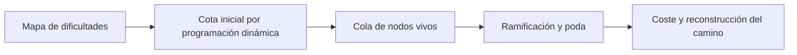

# Camino mínimo con ramificación y poda

**Búsqueda de rutas de coste mínimo en una cuadrícula con ocho movimientos.**

Práctica final individual de **Aitana Cantó Rico** para **Análisis y Diseño de Algoritmos**, Universidad de Alicante.



## Implementación

- C++17 y cola de prioridad para seleccionar nodos.
- Cotas optimistas y pesimistas para limitar la búsqueda.
- Registro del mejor coste conocido por celda.
- Reconstrucción del recorrido y estadísticas de exploración.
- Casos de referencia y comprobador de costes.

## Memoria

La [memoria de la práctica](docs/memoria.pdf) describe las estructuras de datos, los mecanismos de poda, las cotas y los experimentos de rendimiento.

## Compilar y ejecutar

En un entorno con `g++` y `make`:

```bash
make
./build/mcp_bb -f tests/data/002.map --p2D -p
make check
```

[Compilación en Windows y formato de entrada](docs/EJECUCION.md) · [Análisis y alcance](docs/ANALISIS.md) · [Contexto académico](docs/CONTEXTO_ACADEMICO.md)

El código del algoritmo se conserva. El sistema de compilación y el comprobador se han organizado para este repositorio; no se afirma que todos los casos hayan sido ejecutados en el entorno de preparación.
